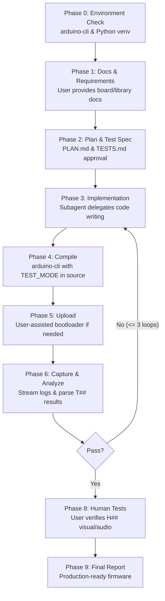

# Arduino Firmware Building Skill

Autonomous build, flash, and test loop for any Arduino-compatible board using `arduino-cli`, serial test logs, and human-in-the-loop assistance.

---

## Overview

The **Arduino Firmware Building** skill enables AI coding assistants (such as Antigravity) to autonomously engineer, implement, compile, upload, and verify firmware for embedded microcontrollers end-to-end.

The skill is completely **board-agnostic**: it makes no assumptions about microcontroller architecture, pinout, or libraries. All hardware specifics and API references are derived strictly from user-provided documentation.

---

## Key Features

- **Strictly Document-Driven**: Works with any board (AVR, ESP32, ESP8266, STM32, RP2040, SAMD, etc.) as long as board specifications and library documentation are provided.
- **Embedded Self-Test Framework**: Includes a lightweight, plain C++11 test harness (`test_harness.h`) that runs automated tests (`T##`) at boot, caches results in RAM, and dumps them on host request (`r`).
- **Separation of Concerns**: Test code is isolated via `test_config.h` (`#define TEST_MODE 1`); production builds compile with zero test overhead.
- **Automated Serial Log Parsing**: `capture_serial.py` and `parse_results.py` stream test output and evaluate pass/fail criteria and crash detection automatically.
- **Interactive Human Verification**: Facilitates manual physical/visual/audio checks (`H##`) with clear, guided prompts for the user.
- **Autonomous Fix Loop**: Automatically diagnoses test failures from serial logs and applies code fixes (up to 3 iterations).

---

## Skill Architecture & Workflow



### Workflow Phases

1. **Phase 0: Environment Check**: Validates `arduino-cli` installation, installed board cores, and ensures the Python virtual environment (`.venv`) has required dependencies (`pyserial`).
2. **Phase 1: User-Provided Docs & Requirements**:
   - The user provides a documentation folder or path containing:
     - **Board Specifications**: Pin mappings, memory, peripherals, upload/bootloader procedure, FQBN, and board options.
     - **Library API Docs**: Classes, methods, and minimal usage examples.
   - The agent validates requirements against available documentation and resolves ambiguities before proceeding.
3. **Phase 2: Plan & Test Specification**:
   - Generates `PLAN.md` (architecture, work packages, FQBN) and `TESTS.md` (mapping requirements to automated `T##` and human `H##` tests).
   - Requires user approval before writing code.
4. **Phase 3: Implementation**:
   - Delegates sketch implementation to a specialized subagent adhering strictly to the plan and documented APIs.
5. **Phase 4: Compilation**:
   - Compiles via `arduino-cli compile -b <FQBN> <sketch>`.
   - `TEST_MODE` is controlled cleanly in source via `test_config.h` without fragile compiler flag overrides.
6. **Phase 5: Assisted Upload**:
   - Detects serial ports and coordinates manual steps (e.g., entering bootloader / download mode or pressing reset) when required by native USB MCUs.
7. **Phase 6: Capture & Analysis**:
   - Uses `capture_serial.py` with `--send r` to trigger result dumps from the board.
   - Evaluates logs using `parse_results.py` with generic crash detection and configurable platform signatures.
8. **Phase 7: Fix Loop**:
   - If any automated test fails, analyzes errors and applies fixes (maximum 3 iterations).
9. **Phase 8: Human Tests**:
   - Coordinates visual and audio observations (`H##`) with the user.
10. **Phase 9: Final Report**:
    - Summarizes verified requirements, test logs, and instructions for optional production builds.

---

## Repository Structure

```
arduino-firmware-building/
├── SKILL.md                 # Master skill prompt and operational instructions
├── README.md                # Skill documentation and reference guide
├── .gitignore               # Excludes python virtual environment and caches
├── references/
│   └── upload-and-ports.md  # Guidelines on native USB port switching and bootloaders
├── resources/
│   ├── PLAN.template.md     # Architecture plan template
│   ├── TESTS.template.md    # Test specification template
│   ├── test_config.h        # Source-level TEST_MODE toggle and RAM config
│   ├── test_harness.h       # C++11 board-agnostic test harness
│   ├── tests.h              # Test suite declarations
│   └── tests.cpp            # Self-test implementation template
└── scripts/
    ├── setup_env.py         # Sets up local Python virtual environment (.venv)
    ├── capture_serial.py    # Serial logger with host trigger support
    ├── parse_results.py     # Log parser with generic and custom crash filters
    └── requirements.txt     # Python dependencies (pyserial)
```

---

## How to Use This Skill

### 1. Installation

Clone or place this repository into your AI agent's configuration skills directory:
```bash
git clone git@github.com:nguyentoanthang/arduino-firmware-building.git ~/.gemini/config/skills/arduino-firmware-building
```

### 2. Invocation

In your coding assistant chat, invoke the skill:
```
/arduino-firmware-building Build firmware for <Board Name> based on the docs in ./docs
```

### 3. What to Provide

For optimal results, ensure your project directory contains a `docs/` folder with:
- **Board Markdown**: Pin definitions, operating voltage, buttons, display pinouts, and FQBN.
- **Library Reference**: Summary of methods and API calls for any attached peripherals (sensors, displays, audio).

---

## License

MIT License. Open for development and extension across embedded Arduino projects.
