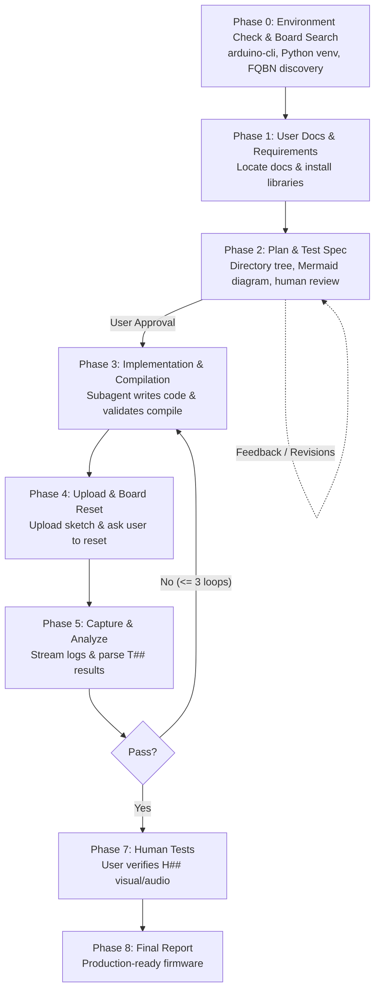

# Arduino Firmware Building Skill

Autonomous build, flash, and test loop for any Arduino-compatible board using `arduino-cli`, serial test logs, and human-in-the-loop assistance.

---

## Overview

The **Arduino Firmware Building** skill enables AI coding assistants to autonomously engineer, implement, compile, upload, and verify firmware for embedded microcontrollers end-to-end.

The skill is completely **board-agnostic**: it makes no hardcoded assumptions about microcontroller architecture, pinouts, or peripheral libraries. All hardware specifics, API references, and board options are discovered interactively or derived strictly from user-provided documentation.

---

## Key Features

- **Strictly Document-Driven**: Works with any arduino compatible boards, given the board specifications and library documentation.
- **Interactive Board & FQBN Search**: Automatically discovers board names, Platform IDs, and exact FQBNs using `arduino-cli board search <name>`.
- **Comprehensive Plan for Human Review**: Generates detailed `PLAN.md` with full project directory trees, per-file API breakdowns, and Mermaid architecture diagrams before any code is written.
- **Human-in-the-Loop Review Gate**: Halts at the end of planning for human review and approval before touching code.
- **Firmware Built with Embedded Tests**: The firmware is built with self-tests embedded directly in the binary (`test_harness.h` & `tests.cpp`), executing automated checks (`T##`) at boot, storing structured records in static RAM, and dumping them on host request (`r`).
- **Controlled via `TEST_MODE`**: The embedded test framework is controlled at the source level via `test_config.h` (`#define TEST_MODE 1`). For production builds, disabling `TEST_MODE` strips out all test code with zero flash or RAM overhead, without modifying board-specific compiler flags.
- **Universal Reset Protocol**: Always instructs the user to reset the board after flashing, guaranteeing firmware boots cleanly across both auto-reset and native USB bootloader boards.
- **Automated Serial Log Parsing**: `capture_serial.py` and `parse_results.py` stream test output and evaluate pass/fail criteria and crash detection automatically.
- **Autonomous Fix Loop**: Automatically diagnoses test failures from serial logs and applies code fixes (up to 3 iterations).

---

## Workflow Architecture



### Detailed Workflow Phases

1. **Phase 0: Environment Check & Board Identification**
   - Validates `arduino-cli` installation and sets up the Python virtual environment (`.venv`).
   - If the user did not specify the board name, prompts the user for it.
   - Searches for the board using `arduino-cli board search <name>` to discover the board, its Platform ID, and exact **FQBN** (retrying if needed, or stopping if not found).
   - Installs the required core platform (`arduino-cli core install <platform_id>`) if not already present.

2. **Phase 1: User-Provided Docs & Requirements**
   - The user provides an input documentation folder or path containing:
     - **Board Specifications**: Pin mappings, peripherals, display/button wiring, upload/bootloader procedure, and configuration options.
     - **Library API Docs**: Classes, methods, and minimal usage examples.
   - Installs any documented libraries needed (`arduino-cli lib install <library_name>`).
   - Validates requirements against available documentation and resolves ambiguities with the user.

3. **Phase 2: Plan & Test Specification (Human Review Gate)**
   - Inspects board configuration options via `arduino-cli board details -b <FQBN>` to build `<FQBN>[:options]`.
   - Generates a rich, human-reviewable `PLAN.md` containing:
     - **Project directory structure** (ASCII tree).
     - **Source file breakdown** (purpose, public APIs, responsibilities, dependencies).
     - **Architecture & data flow diagram** in Mermaid format.
     - **Target board configuration** (FQBN, options, baud rate, reset procedure).
     - **Ordered work packages** for implementation.
   - Generates `TESTS.md` (mapping requirements to automated `T##` and human `H##` tests).
   - **Review Checkpoint (STOP):** Halts and presents `PLAN.md` and `TESTS.md` for human review. Revises upon feedback and proceeds only upon explicit user approval.

4. **Phase 3: Implementation & Compilation (Merged Step)**
   - Delegates sketch implementation and compilation to a subagent adhering strictly to the plan and documented APIs.
   - Compiles via `arduino-cli compile -b <FQBN>[:options] <sketch>` with `TEST_MODE` defined in `test_config.h`.
   - Iterates until code compiles cleanly; implementation is complete only once the sketch builds with zero errors.

5. **Phase 4: Assisted Upload & Board Reset**
   - Handles manual bootloader entry if required by board docs.
   - Flashes sketch with `arduino-cli upload -b <FQBN> -p <PORT> <sketch>`.
   - **Always instructs the user to reset the board** (press physical RESET button or power-cycle) to start running the new firmware, waiting for confirmation before detecting the running serial port.

6. **Phase 5: Capture & Analysis**
   - Uses `capture_serial.py` with `--send r` to trigger stored self-test result dumps from the board.
   - Evaluates logs using `parse_results.py` with generic crash detection and configurable platform signatures.

7. **Phase 6: Fix Loop**
   - If any automated test fails, analyzes errors and applies fixes (maximum 3 iterations).

8. **Phase 7: Human Tests**
   - Coordinates visual, audio, or tactile observations (`H##`) with clear, guided prompts for the user.

9. **Phase 8: Final Report**
   - Summarizes verified requirements, test logs, loops used, and instructions for optional production builds (disabling `TEST_MODE` in `test_config.h`).

---

## Repository Structure

```
arduino-firmware-building/
├── SKILL.md                 # Master skill prompt and operational instructions
├── README.md                # Skill documentation and reference guide
├── .gitignore               # Excludes python virtual environment and caches
├── references/
│   └── upload-and-ports.md  # Guidelines on native USB port switching and bootloaders
├── resources/
│   ├── PLAN.template.md     # Comprehensive architecture plan template for human review
│   ├── TESTS.template.md    # Test specification template
│   ├── test_config.h        # Source-level TEST_MODE toggle and RAM config
│   ├── test_harness.h       # C++11 board-agnostic test harness
│   ├── tests.h              # Test suite declarations
│   └── tests.cpp            # Self-test implementation template
└── scripts/
    ├── setup_env.py         # Sets up local Python virtual environment (.venv)
    ├── capture_serial.py    # Serial logger with host trigger support
    ├── parse_results.py     # Log parser with generic and custom crash filters
    └── requirements.txt     # Python dependencies (pyserial)
```

---

## Prerequisites & Board Setup

- **`arduino-cli`**: Must be installed and available in your system `PATH` (along with Python 3 for virtualenv serial capture scripts).
- **Board Manager & Hardware Setup**:
  1. **If using a custom Board Manager URL:** Ensure the URL is added to the `arduino-cli` configuration before running:
     ```bash
     arduino-cli config add board_manager.additional_urls <board_manager_url>
     arduino-cli core update-index
     ```
     The skill's Phase 0 search will discover the FQBN and install the core automatically.
  2. **If using a custom PCB with a generic chip:** Specify the base chip's FQBN (e.g. `arduino-cli core install esp32:esp32`) and provide the pin mapping in `docs/board.md`. The skill will generate `config.h` matching the custom wiring.

---

## How to Use This Skill

### 1. Prepare Your Project
In your project directory, create a `docs/` folder containing your board pinout and library API references:
```
my_project/
└── docs/
    ├── board.md          # Pin definitions, buttons, display, FQBN notes, bootloader procedure
    └── library_api.md    # API methods and initialization examples
```

---

### 2. Setup & Invocation

Place this repository in your project or your AI tool's global skills folder:

| Tool | Project-Level Folder | Global (User-Level) Folder |
| :--- | :--- | :--- |
| **Claude Code** | `.claude/skills/arduino-firmware-building` | `~/.claude/skills/arduino-firmware-building` |
| **OpenAI Codex** | `.codex/skills/arduino-firmware-building` | `~/.codex/skills/arduino-firmware-building` |
| **Google Antigravity** | `.gemini/skills/arduino-firmware-building` | `~/.gemini/config/skills/arduino-firmware-building` |

**Example Usage:**
```
/arduino-firmware-building build the firmware for <board name>, the requirement are <user requirement>
```

---

## License

MIT License. Open for development, extension, and deployment across embedded Arduino projects.
