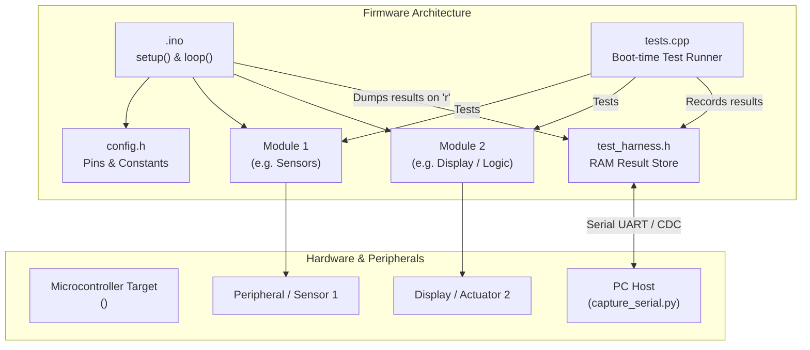

# Implementation Plan: <project name>

## 1. Requirements Overview
- **R1:** <Description of requirement 1>
- **R2:** <Description of requirement 2>
- ...

## 2. Docs Consulted (<docs_folder>)
- `<doc_file>`: Provided board specifications (pinout, clock, peripheral mappings).
- `<library_doc>`: Provided library API details (classes, methods, initializations).
- **Gaps / Unsupported items & resolutions:** <List any hardware or library gaps and how they are addressed>

## 3. Target Board & Hardware Configuration
- **Board Name:** <name>
- **FQBN:** `<FQBN>` (discovered via `arduino-cli board search <name>`)
- **Board Options:** `[:key=value,...]` (verified via `arduino-cli board details -b <FQBN>`, e.g., `CDCOnBoot=cdc,FlashSize=8M`)
- **Full Build Target:** `<FQBN>[:options]`
- **Serial Baud Rate:** <BAUD> (e.g. 115200)
- **Upload Procedure:** <auto-reset | manual bootloader entry (steps from docs)>
- **Reset Procedure:** <manual physical reset button / power-cycle sequence to run firmware>
- **Connected Peripherals & Pins:**
  - Peripheral 1: Pin mapping / bus (e.g. SDA=GPIO21, SCL=GPIO22)
  - Peripheral 2: ...

## 4. Planned Project Directory Structure
```
<sketch_folder>/
├── <sketch_folder>.ino      # Main sketch: setup(), loop(), module initialization
├── config.h                 # Hardware pin definitions, constants, peripheral configs
├── <module1>.h              # Header for module 1 (interface / class declarations)
├── <module1>.cpp            # Implementation of module 1
├── <module2>.h              # Header for module 2
├── <module2>.cpp            # Implementation of module 2
├── test_config.h            # Test toggle switch and RAM buffer limits (TEST_MODE)
├── test_harness.h           # Board-agnostic C++11 test reporting harness
├── tests.h                  # Declarations of self-test suites
├── tests.cpp                # Self-test implementations for T## test IDs
└── logs/                    # Serial run logs and test results (run<N>.log, run<N>.json)
```

## 5. Source File Breakdown & Responsibilities

| File | Purpose & Responsibilities | Key Functions / Classes | Dependencies |
|---|---|---|---|
| `<sketch>.ino` | Entry point. Coordinates setup(), main loop, task dispatching, and serial test dump service (`TEST_SERVICE()`). | `setup()`, `loop()` | All modules, `test_harness.h` |
| `config.h` | Central pin mappings, timing constants, hardware configurations. | Macros / constexpr constants | None |
| `<module1>.h/.cpp` | Encapsulates peripheral/feature 1 (e.g., sensor reading, display rendering). | `module1_init()`, `module1_read()`, ... | `config.h`, `<vendor_lib>` |
| `test_config.h` | Master `#define TEST_MODE 1` switch and RAM allocation tuning. | Macro switches | Standard headers |
| `test_harness.h` | In-memory test store singleton and serial result formatting. | `_t_store()`, `TEST_DUMP()`, `TEST_SERVICE()` | Standard Arduino |
| `tests.h/.cpp` | Self-tests executed once at boot in `setup()` under `TEST_MODE`. | `run_all_tests()`, test cases for `T##` | `test_harness.h`, `<modules>` |

## 6. Architecture & Data Flow Diagram

<!-- NOTE: All node labels with parentheses must use double quotes: ["Text (details)"]. Edge labels must never use unquoted parentheses |func()| as it causes parse error 'got PS'; use |Calls func| or |"func()"|. -->


## 7. Test Strategy & Verification
- **Test Mode Toggle:** Activated via `#define TEST_MODE 1` in `test_config.h`.
- **Boot Execution:** Self-tests run once during `setup()`, caching structured results into static RAM (`TestRecord`).
- **On-Demand Serial Dump:** `TEST_SERVICE()` listens in `loop()` for `'r'` character sent by `capture_serial.py --send r` and streams `[TEST]` records.
- **Automated Tests:** Mapped to IDs `T01`, `T02`, ... in `TESTS.md`.
- **Human Verification:** Mapped to IDs `H01`, `H02`, ... in `TESTS.md`.

## 8. Work Packages (Implementation Steps)
1. **WP1: Project Setup & Harness Configuration**
   - Copy `test_config.h`, `test_harness.h`, `tests.h`, `tests.cpp` into sketch directory.
   - Configure memory bounds and verify baud rate.
2. **WP2: Core Hardware & Configuration Module**
   - Implement `config.h` with pins mapped from documentation.
3. **WP3: Feature Modules Implementation**
   - Implement `<module1>.h/.cpp` and `<module2>.h/.cpp` using documented APIs.
4. **WP4: Self-Test Implementation**
   - Implement test cases in `tests.cpp` for each `T##` test ID.
5. **WP5: Main Sketch Integration & Compilation**
   - Wire modules and harness into `<sketch>.ino`.
   - Compile cleanly with `arduino-cli compile -b <FQBN>[:options] <sketch>`.

## 9. Risks, Assumptions & Open Questions
- **Memory / RAM limits:** <Risk evaluation and mitigations>
- **Hardware timing / reset behavior:** <Notes on reset and native USB CDC timing>
- **Open questions for user:** <Any remaining points or constraints>
