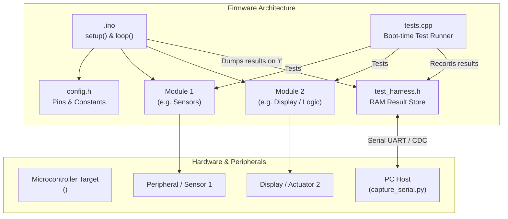

# Implementation Plan: <project name>

## 1. Requirements Overview
- **R1:** <Description of requirement 1>
- **R2:** <Description of requirement 2>
- ...

## 2. Docs Consulted (<docs_folder>)
- `<doc_file>`: Provided board specifications (pinout, clock, peripheral mappings).
- `<library_doc>`: Provided library API details (classes, methods, initializations).
- **Gaps / Unsupported items & resolutions:** <List any hardware or library gaps and how they are addressed>

## 3. Target Board & Hardware Configuration
- **Board Name:** <name>
- **FQBN:** `<FQBN>` (discovered via `arduino-cli board search <name>`)
- **Board Options:** `[:key=value,...]` (verified via `arduino-cli board details -b <FQBN>`, e.g., `CDCOnBoot=cdc,FlashSize=8M`)
- **Full Build Target:** `<FQBN>[:options]`
- **Serial Baud Rate:** <BAUD> (e.g. 115200)
- **Upload Procedure:** <auto-reset | manual bootloader entry (steps from docs)>
- **Reset Procedure:** <manual physical reset button / power-cycle sequence to run firmware>
- **Connected Peripherals & Pins:**
  - Peripheral 1: Pin mapping / bus (e.g. SDA=GPIO21, SCL=GPIO22)
  - Peripheral 2: ...

## 4. Planned Project Directory Structure
```
<sketch_folder>/
├── <sketch_folder>.ino      # Main sketch: setup(), loop(), module initialization
├── config.h                 # Hardware pin definitions, constants, peripheral configs
├── <module1>.h              # Header for module 1 (interface / class declarations)
├── <module1>.cpp            # Implementation of module 1
├── <module2>.h              # Header for module 2
├── <module2>.cpp            # Implementation of module 2
├── test_config.h            # Test toggle switch and RAM buffer limits (TEST_MODE)
├── test_harness.h           # Board-agnostic C++11 test reporting harness
├── tests.h                  # Declarations of self-test suites
├── tests.cpp                # Self-test implementations for T## test IDs
└── logs/                    # Serial run logs and test results (run<N>.log, run<N>.json)
```

## 5. Source File Breakdown & Responsibilities

| File | Purpose & Responsibilities | Key Functions / Classes | Dependencies |
|---|---|---|---|
| `<sketch>.ino` | Entry point. Coordinates setup(), main loop, task dispatching, and serial test dump service (`TEST_SERVICE()`). | `setup()`, `loop()` | All modules, `test_harness.h` |
| `config.h` | Central pin mappings, timing constants, hardware configurations. | Macros / constexpr constants | None |
| `<module1>.h/.cpp` | Encapsulates peripheral/feature 1 (e.g., sensor reading, display rendering). | `module1_init()`, `module1_read()`, ... | `config.h`, `<vendor_lib>` |
| `test_config.h` | Master `#define TEST_MODE 1` switch and RAM allocation tuning. | Macro switches | Standard headers |
| `test_harness.h` | In-memory test store singleton and serial result formatting. | `_t_store()`, `TEST_DUMP()`, `TEST_SERVICE()` | Standard Arduino |
| `tests.h/.cpp` | Self-tests executed once at boot in `setup()` under `TEST_MODE`. | `run_all_tests()`, test cases for `T##` | `test_harness.h`, `<modules>` |

## 6. Architecture & Data Flow Diagram

<!-- NOTE: All node labels with parentheses must use double quotes: ["Text (details)"]. Edge labels must never use unquoted parentheses |func()| as it causes parse error 'got PS'; use |Calls func| or |"func()"|. -->


## 7. Test Strategy & Edge-Case Verification

### 7.1 Architecture & Control
- **Test Mode Toggle:** Activated via `#define TEST_MODE 1` in `test_config.h`. Production builds disable `TEST_MODE` to strip all test code with zero overhead.
- **Boot Execution:** Self-tests run once during `setup()`, storing structured records in static RAM (`TestRecord`).
- **On-Demand Serial Dump:** `TEST_SERVICE()` listens in `loop()` for `'r'` character sent by `capture_serial.py --send r` and streams `[TEST]` records without unsolicited blocking prints.
- **Harness Capacity:** Configure `TEST_MAX_RECORDS` in `test_config.h` to match or exceed the total planned test count (`T##` + `H##`).

### 7.2 Multi-Category Test Matrix
> [!IMPORTANT]
> Basic happy-path tests are easy to pass and mask critical bugs. All requirements must include rigorous edge-case and failure-mode checks across the following categories:
> 1. **Nominal (`NOM`):** Standard operational checks with typical valid parameters.
> 2. **Boundary & Extremes (`BND`):** Min/max limits, zero values, integer overflow, buffer limits, string truncation.
> 3. **Negative & Invalid Input (`NEG`):** `NULL` pointers, out-of-range parameters, invalid commands (graceful error return without crashing).
> 4. **Fault Simulation & Resilience (`FLT`):** Communication timeouts, disconnected sensor / I2C NACK fallback, non-blocking execution (no infinite `while` loops).
> 5. **State Machine Lifecycle (`STA`):** Re-initialization idempotency, uninitialized calls, state recovery.
> 6. **Timing & Asynchrony (`TIM`):** Rapid pulse chatter, debounce boundaries, `millis()` wraparound safety.
> 7. **Human Edge-Case Verification (`HUM`):** Display boundary rendering with maximum length strings, visual fault alert indicators on error.

### 7.3 Edge Case & Failure Mode Mapping
| Failure Mode / Edge Case | Risk Level | Mitigation & Firmware Handling | Test ID | Type |
|---|---|---|---|---|
| Sensor / Peripheral Disconnect | High | Non-blocking timeout (`millis()`); returns error status without hanging | `T07` | auto |
| Buffer Overrun on Long Input | High | Explicit length clamping (`BUF_SIZE - 1`) and null termination | `T04` | auto |
| Out-of-Range Parameter / Sensor Glitch | Medium | Clamped to safe min/max bounds | `T02`, `T03` | auto |
| NULL Pointer passed to API | High | Parameter validation at function entry returning error code | `T05` | auto |
| Invalid Command / Enum | Medium | Rejection with error status; state preserved | `T06` | auto |
| Double `begin()` or Early Call | Medium | Guarded by `is_initialized` state flags | `T08`, `T09` | auto |
| Rapid Switch Chatter / Bouncing | Medium | Time-based debounce window rejects short pulses | `T10` | auto |
| Max String Length on Display | Medium | UI buffer truncation to prevent visual clipping or heap corruption | `H02` | human |

## 8. Work Packages (Implementation Steps)
1. **WP1: Project Setup & Harness Configuration**
   - Copy `test_config.h`, `test_harness.h`, `tests.h`, `tests.cpp` into sketch directory.
   - Configure memory bounds (`TEST_MAX_RECORDS`) and baud rate in `test_config.h`.
2. **WP2: Core Hardware & Configuration Module**
   - Implement `config.h` with pins mapped from documentation.
3. **WP3: Feature Modules Implementation (Defensive Embedded Design)**
   - Implement `<module1>.h/.cpp` and `<module2>.h/.cpp` using documented APIs.
   - Apply defensive guards: NULL pointer checks, non-blocking timeouts with `millis()`, buffer bounds clamping.
4. **WP4: Comprehensive Self-Test Implementation**
   - Implement test cases in `tests.cpp` covering nominal checks, boundary limits, negative inputs, fault resilience, state transitions, and timing edge cases.
5. **WP5: Main Sketch Integration & Compilation**
   - Wire modules and harness into `<sketch>.ino`.
   - Compile cleanly with `arduino-cli compile -b <FQBN>[:options] <sketch>`.

## 9. Risks, Assumptions & Open Questions
- **Memory / RAM limits:** <Risk evaluation and mitigations>
- **Hardware timing / reset behavior:** <Notes on reset and native USB CDC timing>
- **Open questions for user:** <Any remaining points or constraints>
