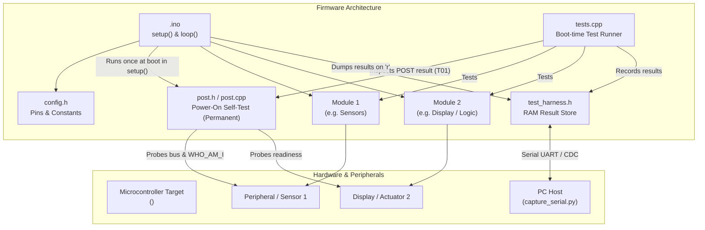

# Implementation Plan: <project name>

## 1. Requirements Overview
- **R1:** <Description of requirement 1>
- **R2:** <Description of requirement 2>
- ...
- **POST Strategy (User-Selected):** <Enabled (default) | Disabled per user request | Custom approach: e.g. non-blocking degraded mode, specific fault indicators>

## 2. Docs Consulted (<docs_folder>)
- `<doc_file>`: Provided board specifications (pinout, clock, peripheral mappings).
- `<library_doc>`: Provided library API details (classes, methods, initializations).
- **Gaps / Unsupported items & resolutions:** <List any hardware or library gaps and how they are addressed>

## 3. Target Board & Hardware Configuration
- **Board Name:** <name>
- **FQBN:** `<FQBN>` (discovered via `arduino-cli board search <name>`)
- **Board Options:** `[:key=value,...]` (verified via `arduino-cli board details -b <FQBN>`, e.g., `CDCOnBoot=cdc,FlashSize=8M`)
- **Full Build Target:** `<FQBN>[:options]`
- **Serial Baud Rate:** <BAUD> (e.g. 115200)
- **Upload Procedure:** <auto-reset | manual bootloader entry (steps from docs)>
- **Reset Procedure:** <manual physical reset button / power-cycle sequence to run firmware>
- **Connected Peripherals & Pins:**
  - Peripheral 1: Pin mapping / bus (e.g. SDA=GPIO21, SCL=GPIO22)
  - Peripheral 2: ...

## 4. Planned Project Directory Structure
```
<sketch_folder>/
├── <sketch_folder>.ino      # Main sketch: setup(), loop(), module initialization
├── config.h                 # Hardware pin definitions, constants, peripheral configs
├── post.h                   # Permanent Power-On Self-Test (POST) declarations
├── post.cpp                 # Permanent production hardware health checks (buses, IDs, rails)
├── <module1>.h              # Header for module 1 (interface / class declarations)
├── <module1>.cpp            # Implementation of module 1
├── <module2>.h              # Header for module 2
├── <module2>.cpp            # Implementation of module 2
├── test_config.h            # Test toggle switch and RAM buffer limits (TEST_MODE)
├── test_harness.h           # Board-agnostic C++11 test reporting harness
├── tests.h                  # Declarations of self-test suites
├── tests.cpp                # Self-test implementations for T## test IDs
└── logs/                    # Serial run logs and test results (run<N>.log, run<N>.json)
```

## 5. Source File Breakdown & Responsibilities (API Contract)

<!-- NOTE: Specify exact function signatures and return types below so Subagent 1 (Functional Code) and Subagent 2 (Test Cases) implement against the exact same API contract in parallel. -->

| File | Owner | Purpose & Responsibilities | Exact Public APIs / Signatures | Dependencies |
|---|---|---|---|---|
| `<sketch>.ino` | Subagent 1 & 3 | Entry point. Coordinates `setup()`, `loop()`, hardware POST, and test dump hooks (`run_all_tests()`, `TEST_SERVICE()`). | `void setup()`, `void loop()` | All modules, `post.h`, `tests.h`, `test_harness.h` |
| `config.h` | Subagent 1 | Central pin mappings, timing constants, hardware configurations. | Macros / `constexpr` constants | None |
| `post.h/.cpp` | Subagent 1 | **Permanent Power-On Self-Test (POST)**. Verifies physical bus integrity, device presence, `WHO_AM_I` registers, and rails at boot in `setup()`. Remains in production firmware. | `PostResult post_run()`, `const PostResult& post_get_result()`, `void post_handle_failure(...)` | `config.h`, `<vendor_lib>` |
| `<module1>.h/.cpp` | Subagent 1 | Encapsulates peripheral/feature 1 (e.g., sensor reading, display rendering). | `bool module1_init()`, `int module1_read(int* out)`, ... | `config.h`, `<vendor_lib>` |
| `test_config.h` | Subagent 2 | Master `#define TEST_MODE 1` switch and RAM allocation tuning (`TEST_MAX_RECORDS`). | Macro switches | Standard headers |
| `test_harness.h` | Subagent 2 | In-memory test store singleton and serial result formatting. | `_t_store()`, `TEST_DUMP()`, `TEST_SERVICE()`, `TEST_ASSERT_*` | Standard Arduino |
| `tests.h/.cpp` | Subagent 2 | Self-tests executed once at boot in `setup()` under `TEST_MODE`. Verifies POST results and software requirements. | `void run_all_tests()` (reports all `T##` & `H##` IDs) | `test_harness.h`, `post.h`, `<modules>` |

## 6. Architecture & Data Flow Diagram

<!-- NOTE: All node labels with parentheses must use double quotes: ["Text (details)"]. Edge labels must never use unquoted parentheses |func()| as it causes parse error 'got PS'; use |Calls func| or |"func()"|. -->


## 7. Test Strategy & Edge-Case Verification

### 7.1 Architecture & Control
- **Production Hardware Health (POST):** Permanent Power-On Self-Test (`post.h`/`post.cpp`) runs once at boot in `setup()`. Probes buses, reads device ID / `WHO_AM_I` registers, and checks power rail sanity. Remains compiled in production firmware. *(Configured per user preference in Phase 1b: enabled, customized fault behavior, or omitted if explicitly disabled).*
- **Test Mode Toggle:** Activated via `#define TEST_MODE 1` in `test_config.h`. Production builds disable `TEST_MODE` to strip all test code with zero overhead.
- **Boot Execution:** Self-tests run once during `setup()`, storing structured records in static RAM (`TestRecord`).
- **On-Demand Serial Dump:** `TEST_SERVICE()` listens in `loop()` for `'r'` character sent by `capture_serial.py --send r` and streams `[TEST]` records without unsolicited blocking prints.
- **Harness Capacity:** Configure `TEST_MAX_RECORDS` in `test_config.h` to match or exceed the total planned test count (`T##` + `H##`).

### 7.2 Multi-Category Test Matrix
> [!IMPORTANT]
> Basic happy-path tests are easy to pass and mask critical bugs. All requirements must include rigorous edge-case and failure-mode checks across the following categories:
> 1. **Hardware Power-On Self-Test (`PST`):** Permanent production checks verifying physical bus integrity, device presence, `WHO_AM_I` / chip IDs, and power rails at boot.
> 2. **Nominal (`NOM`):** Standard operational checks with typical valid parameters.
> 3. **Boundary & Extremes (`BND`):** Min/max limits, zero values, integer overflow, buffer limits, string truncation.
> 4. **Negative & Invalid Input (`NEG`):** `NULL` pointers, out-of-range parameters, invalid commands (graceful error return without crashing).
> 5. **Fault Simulation & Resilience (`FLT`):** Communication timeouts, disconnected sensor / I2C NACK fallback, non-blocking execution (no infinite `while` loops).
> 6. **State Machine Lifecycle (`STA`):** Re-initialization idempotency, uninitialized calls, state recovery.
> 7. **Timing & Asynchrony (`TIM`):** Rapid pulse chatter, debounce boundaries, `millis()` wraparound safety.
> 8. **Human Edge-Case Verification (`HUM`):** Display boundary rendering with maximum length strings, visual fault alert indicators on error.

### 7.3 Edge Case & Failure Mode Mapping
| Failure Mode / Edge Case | Risk Level | Mitigation & Firmware Handling | Test ID | Type |
|---|---|---|---|---|
| Hardware Disconnect / Dead at Boot | High | Power-On Self-Test (`post.h/.cpp`) in `setup()` checks bus ACK & `WHO_AM_I`; enters safe state | `T01` | auto |
| Sensor / Peripheral Disconnect Mid-run | High | Non-blocking timeout (`millis()`); returns error status without hanging | `T08` | auto |
| Buffer Overrun on Long Input | High | Explicit length clamping (`BUF_SIZE - 1`) and null termination | `T05` | auto |
| Out-of-Range Parameter / Sensor Glitch | Medium | Clamped to safe min/max bounds | `T03`, `T04` | auto |
| NULL Pointer passed to API | High | Parameter validation at function entry returning error code | `T06` | auto |
| Invalid Command / Enum | Medium | Rejection with error status; state preserved | `T07` | auto |
| Double `begin()` or Early Call | Medium | Guarded by `is_initialized` state flags | `T09`, `T10` | auto |
| Rapid Switch Chatter / Bouncing | Medium | Time-based debounce window rejects short pulses | `T11` | auto |
| Max String Length on Display | Medium | UI buffer truncation to prevent visual clipping or heap corruption | `H02` | human |

## 8. Work Packages (3-Subagent Implementation Pipeline)
1. **WP1 — Functional Firmware Implementation (Subagent 1, runs in parallel with WP2)**
   - Implement `config.h` with pins and constants mapped strictly from board documentation.
   - Implement permanent Power-On Self-Test (`post.h` and `post.cpp`) verifying physical hardware presence (I2C/SPI bus ACK, sensor `WHO_AM_I`, rail sanity).
   - Implement feature modules (`<module1>.h/.cpp`, `<module2>.h/.cpp`) and core `<sketch>.ino` logic matching the exact API contract in Section 5.
   - Apply defensive embedded design: `NULL` pointer guards, boundary clamping, initialization state flags, and non-blocking `millis()` timeouts.
   - Do not modify test files (`test_config.h`, `test_harness.h`, `tests.h`, `tests.cpp`) or run compilation.
2. **WP2 — Comprehensive Test Suite Implementation (Subagent 2, runs in parallel with WP1)**
   - Copy `test_config.h`, `test_harness.h`, and `tests.h` into the sketch directory and size `TEST_MAX_RECORDS` in `test_config.h`.
   - Implement all test cases (`T##` and `H##`) in `tests.cpp` against the Section 5 API signatures, including `T01` (asserting `post_get_result().all_passed == true`), nominal checks, boundary limits, negative inputs, fault resilience, state transitions, and timing edge cases.
   - Do not modify functional source files or run compilation.
3. **WP3 — Check, Integration & Compilation (Subagent 3, spawned after WP1 & WP2 complete)**
   - Cross-check all implemented module signatures and test cases against `PLAN.md` and `TESTS.md`.
   - Integrate permanent hardware POST execution (`post_run()`) and fault handling into `<sketch>.ino`'s `setup()`.
   - Integrate test hooks (`run_all_tests()` in `setup()` and `TEST_SERVICE()` in `loop()`) and header includes into `<sketch>.ino`.
   - Compile cleanly with `arduino-cli compile -b <FQBN>[:options] <sketch>` under `TEST_MODE`, resolving any integration or build errors until zero errors remain.

## 9. Risks, Assumptions & Open Questions
- **Memory / RAM limits:** <Risk evaluation and mitigations>
- **Hardware timing / reset behavior:** <Notes on reset and native USB CDC timing>
- **Open questions for user:** <Any remaining points or constraints>
